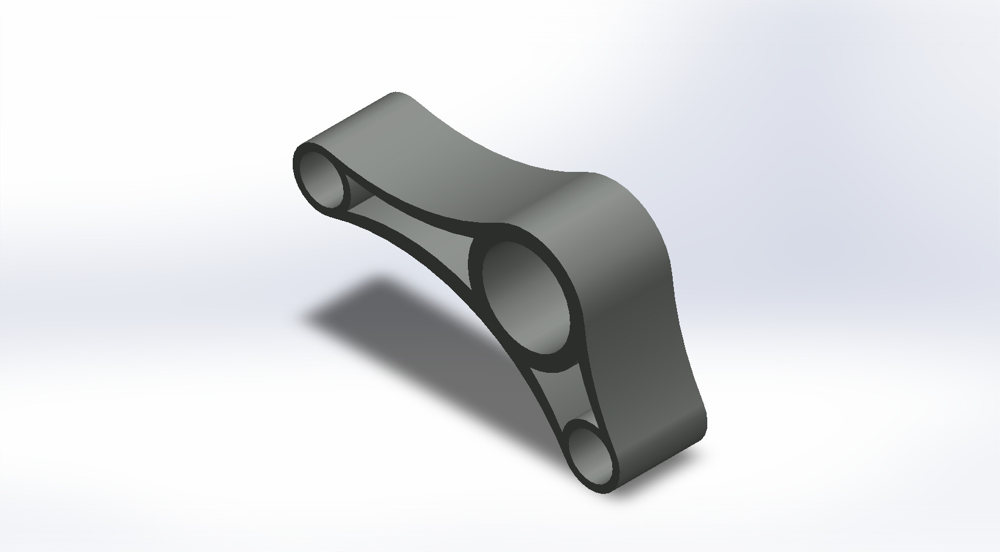
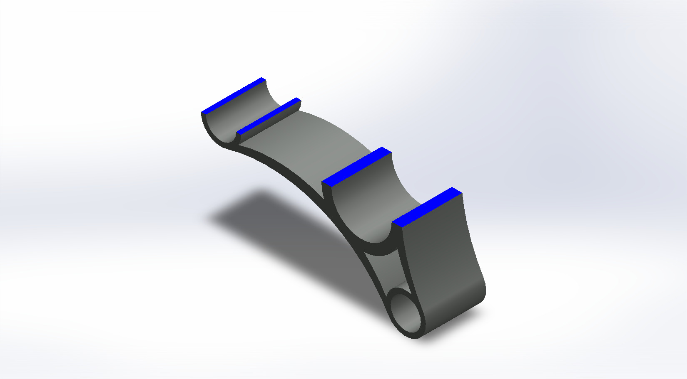

# A Curved Bell Crank with a Large Pivot Bore and Two End Bores

## Summary

A bell crank is a lever with two arms that meet at a central pivot and turn a push or pull in one direction into motion in another direction. The lengths of the two arms set how force and travel are traded against each other, which is why such levers appear in aircraft control linkages, vehicle suspensions, and many other mechanisms.

The model is a curved, boomerang-shaped arm with a large bore at the elbow and a smaller bore at the end of each arm. The two arms are of unequal length and meet at an angle wider than a right angle. The material between the bores is cut away into two open windows, which leaves only thin walls around the outline and around each bore, and the whole shape is extruded to one uniform depth. The bell crank was developed as a computational model in SolidWorks. The views below show the outline from the front and back, the edge-on sides, and a section cut through the bores. This prototype is a base concept design that can be developed further into a working linkage part.

---

## Computational Design

|   View    | Image |
| :-------: | :---: |
| Isometric |  |
| Left |  |
| Right |  |
| Back |  |
| Front |  |
| Top |  |
| Bottom |  |
| Section |  |

---

## Software Used

| Purpose |               Name                |
| :-----: | :-------------------------------: |
| Design  | SolidWorks 2024 (Student Version) |

---

## Applications [^1][^2][^3][^4]

- Aircraft Flight Control Linkages for Ailerons, Elevators, and Rudders
- Pushrod and Pullrod Suspension Rockers in Race Cars
- Throttle and Brake Pedal Linkages in Road Vehicles
- Cantilever and Centre-Pull Bicycle Brake Linkages
- Valve Gear on Steam Locomotives
- Industrial Press Clamps that Turn Horizontal Motion into Vertical Clamping
- Robotic Grippers Driven by Mirrored Bell Cranks

---

## Design Limitations

The design of the bell crank was developed as a geometric prototype. That’s why the real-life design considerations, including material selection, strength and fatigue analysis, bore tolerances and fits, bushing or bearing selection, the arm-length ratio and range of motion, manufacturing process, and feasibility, have not been included.

---

## Future Improvements

The arm lengths and the angle between the arms should first be set from the required motion ratio and travel of a real linkage. Bushings or bearings and a pivot pin can then be added to the large bore, with proper fits, and pin or rod-end connections to the two end bores. An assembly with the two connecting links and a motion study would verify the travel and show how the motion ratio changes as the lever swings. The wall thickness around the outline and the bores should be chosen with a stress analysis, together with a material choice and fillets at the sharp inner corners of the windows. A manufacturing method such as machining or casting should also be considered, because it decides how thin the walls can be.

---

## Feature Tree

| No  | Name |
| :-: | :--: |

---

## Feature Tree Image

| No  | Image |
| :-: | :---: |

---

## Acknowledgements

I would like to thank the [CAD CAM Tutorials](https://www.youtube.com/c/CADCAMTutorials) YouTube channel for its tutorials and learning resources, and [Mr. Md. Abdus Salam](https://mpe.iutoic-dhaka.edu/profile/salam/education), Drafting Instructor, Department of Mechanical and Production Engineering, Islamic University of Technology, for his guidance and support, and for his assistance in our ME 4210 3D Solid Modeling and Assembling lab course. I took assistance from [Claude](https://claude.ai), an AI assistant by [Anthropic](https://www.anthropic.com), in preparing this documentation. I provided the template, and Claude followed it and my instructions.

---

## References

[^1]: [Bellcrank - Wikipedia](https://en.wikipedia.org/wiki/Bellcrank)

[^2]: [Bell-crank Lever (changing Direction of Force): Mechanism, Diagram, Animation & Calculator Explained](https://www.firgelliauto.com/blogs/mechanisms/bell-crank-lever-changing-direction-of-force)

[^3]: [Suspension Rockers (Bellcranks) in F1](https://www.formula1-dictionary.net/f1-suspension-rockers/)

[^4]: [ICON A5 MM : Flight Controls : Flight Control System Description](https://www.iconaircraft.com/maintenance-manual-A5/ICON%20A5%20MM/Introduction_ControlSystems.html)
