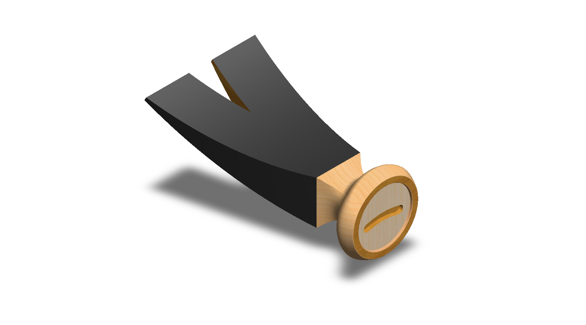
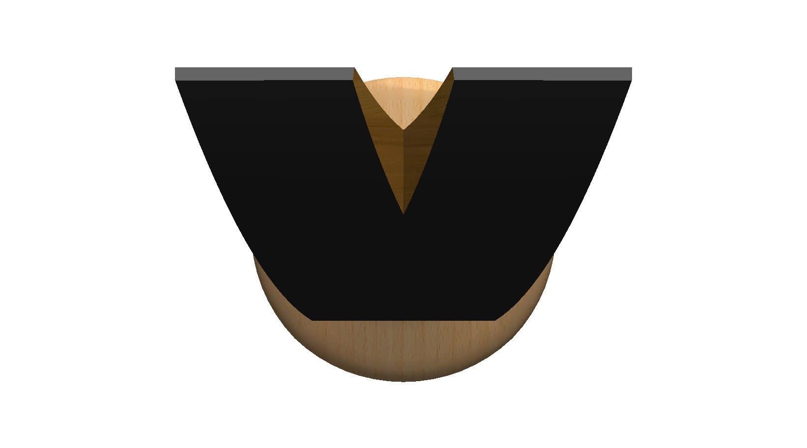
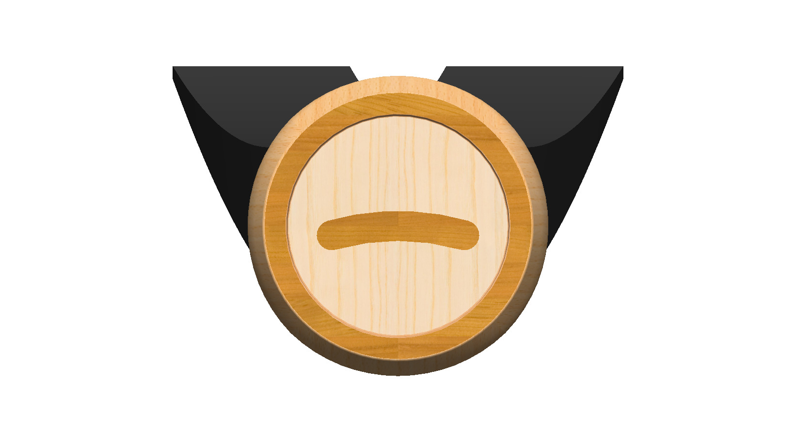
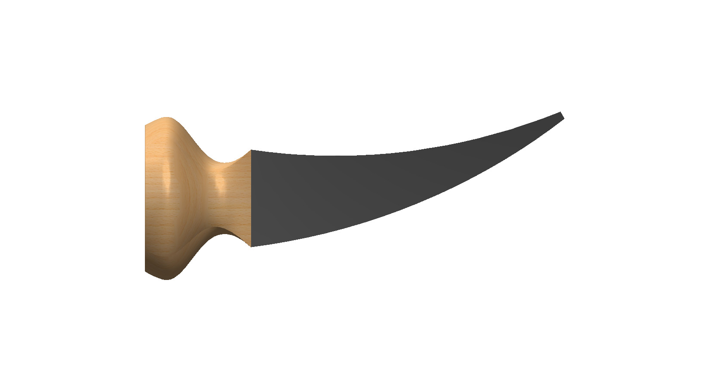
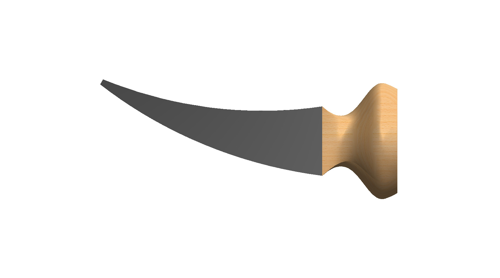
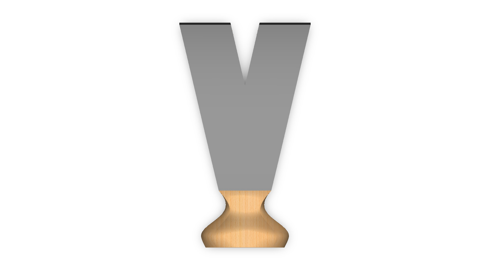
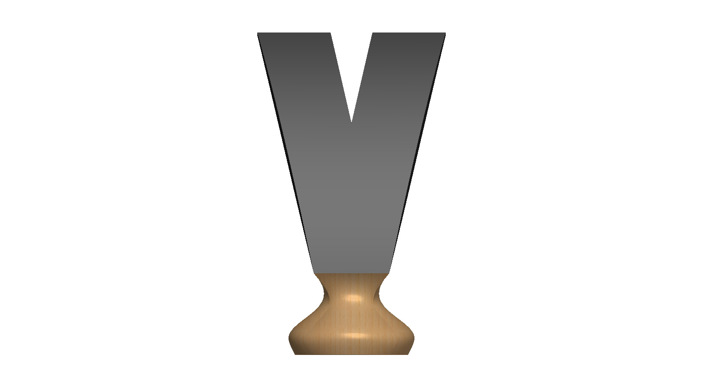
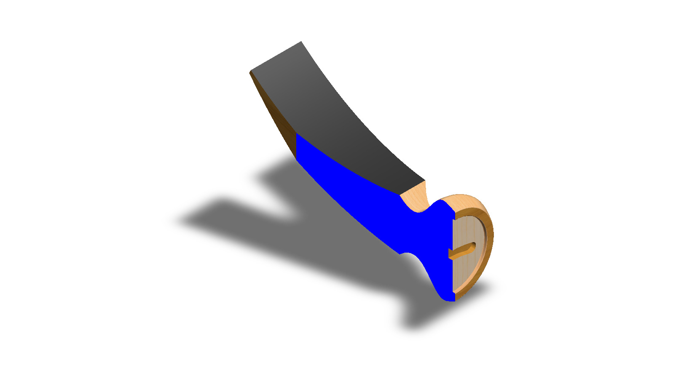

# A Claw Hammer Head with a Curved Forked Claw and a Round Face

## Summary

A claw hammer head puts two tools on one piece of steel: a flat face for driving nails and a forked, curved claw for pulling them out and prying boards apart. Because the claw works as a lever and the face takes repeated impacts, the shape of each end decides how well the hammer works.

The model is a claw-hammer-style head without an eye for a handle. At one end, a narrow neck flares like a bell into a round face with a rim around a shallow recessed center that carries a short curved slot. At the other end, a thick curved claw widens and thins toward its tips and is split by a V-shaped slot that ends in a point. In the renders the claw is black and the face end has a wood-like texture. The part was developed as a computational model in SolidWorks. This prototype is a base concept design that can be developed further into a complete hammer head with an eye and a handle.

---

## Computational Design

|   View    |                                                                                                                           Image                                                                                                                           |
| :-------: | :-------------------------------------------------------------------------------------------------------------------------------------------------------------------------------------------------------------------------------------------------------: |
| Isometric |                                                            |
|   Left    |                                          |
|   Right   |                       |
|   Back    |                                              |
|   Front   |                                            |
|    Top    |                                                    |
|  Bottom   |                            |
|  Section  |  |

---

## Software Used

| Purpose |               Name                |
| :-----: | :-------------------------------: |
| Design  | SolidWorks 2024 (Student Version) |

---

## Applications [^1][^2][^3][^4][^5]

- Driving and Pulling Nails in General Carpentry
- Framing and Rough Carpentry (Heavier Heads with Straighter Claws)
- Prying Up Floorboards and Separating Nailed Boards
- Demolition and Ripping Work with Straight-Claw Hammers
- Household and DIY Projects such as Hanging Pictures and Building Sheds and Fences
- Woodworking and Joining Timber
- Trade-Specific Variants such as Electrician’s Hammers with Non-Conductive Handles

---

## Design Limitations

The design of the claw hammer head was developed as a geometric prototype. That’s why the real-life design considerations, including material selection and heat treatment, impact and stress analysis, the eye and wedge for fitting a handle, face and claw hardness, weight and balance, tolerances & fits, manufacturing process, and safety standards, have not been included.

---

## Future Improvements

An eye should be added through the head between the face and the claw, so that a handle (wood, fiberglass, or steel) and a wedge can be modeled and assembled with it. The cheeks of the head should be added around the eye, and the face should get a slight convexity, a chamfered edge, and optionally a milled pattern for grip. The curved claw can be compared with a straighter rip claw for prying, and the dimensions can be set to a standard head weight, such as 16 oz, with the face and claw weighing about the same for good balance. A steel material should then be assigned, and a simulation of striking and nail-pulling loads should be run to check the neck and cheek areas, where the head is under the most stress. Finally, 2D drawings with dimensions and tolerances can be prepared for manufacturing.

---

## Feature Tree

| No  | Name |
| :-: | :--: |

---

## Feature Tree Image

| No  | Image |
| :-: | :---: |

---

## Acknowledgements

I would like to thank the [CAD CAM Tutorials](https://www.youtube.com/c/CADCAMTutorials) YouTube channel for its tutorials and learning resources, and [Mr. Md. Abdus Salam](https://mpe.iutoic-dhaka.edu/profile/salam/education), Drafting Instructor, Department of Mechanical and Production Engineering, Islamic University of Technology, for his guidance and support, and for his assistance in our ME 4210 3D Solid Modeling and Assembling lab course. I took assistance from [Claude](https://claude.ai), an AI assistant by [Anthropic](https://www.anthropic.com), in preparing this documentation. I provided the template, and Claude followed it and my instructions.

---

## References

[^1]: [Claw hammer](https://en.wikipedia.org/wiki/Claw_hammer)

[^2]: [Parts of a Hammer](https://www.finepowertools.com/hand-tools/hammer-parts/)

[^3]: [25 Types of Hammers and How to Use Them](https://www.bobvila.com/articles/types-of-hammers/)

[^4]: [Hammer Buying Guide | Screwfix](https://www.screwfix.ie/guides/tools/hammer-buying-guide)

[^5]: [Hammer Buying Guide | Hammer Types Explained | Toolstation](https://www.toolstation.com/help-and-advice/buying-guides/hammer-buying-guide)
