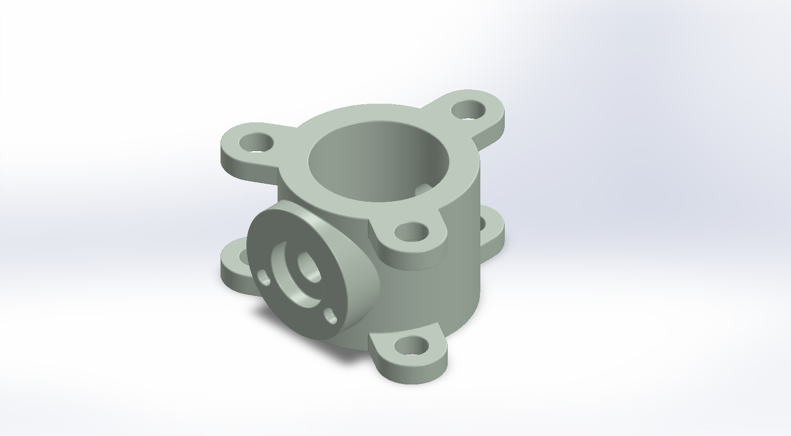
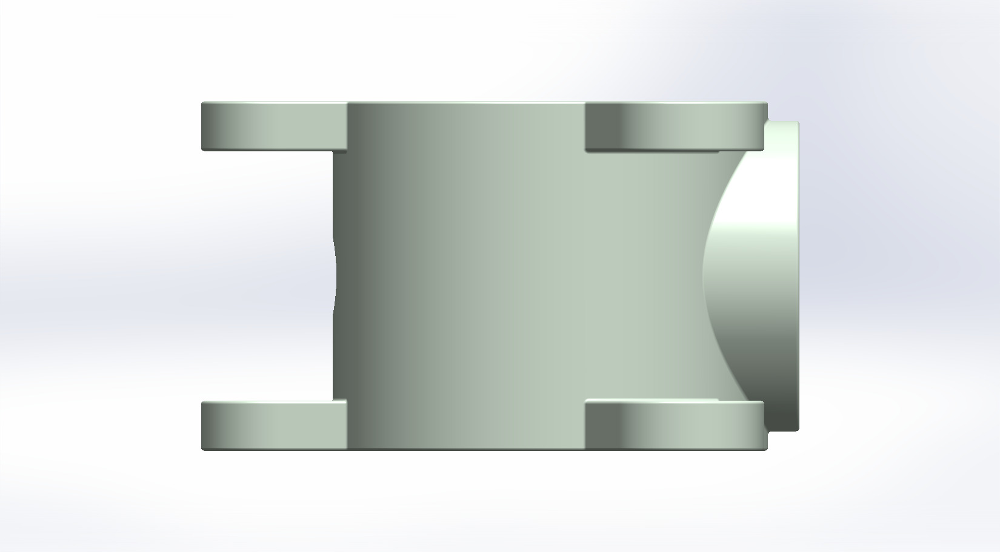
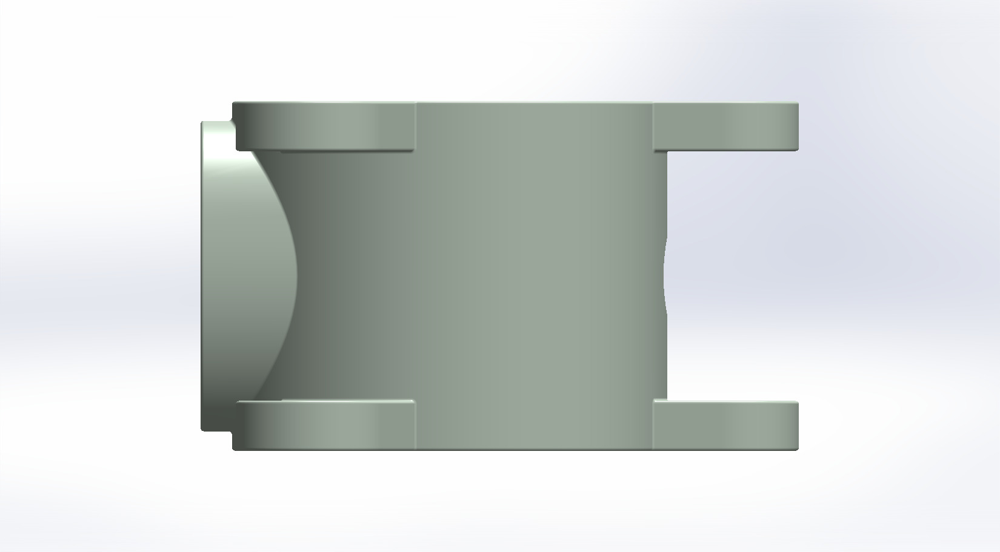
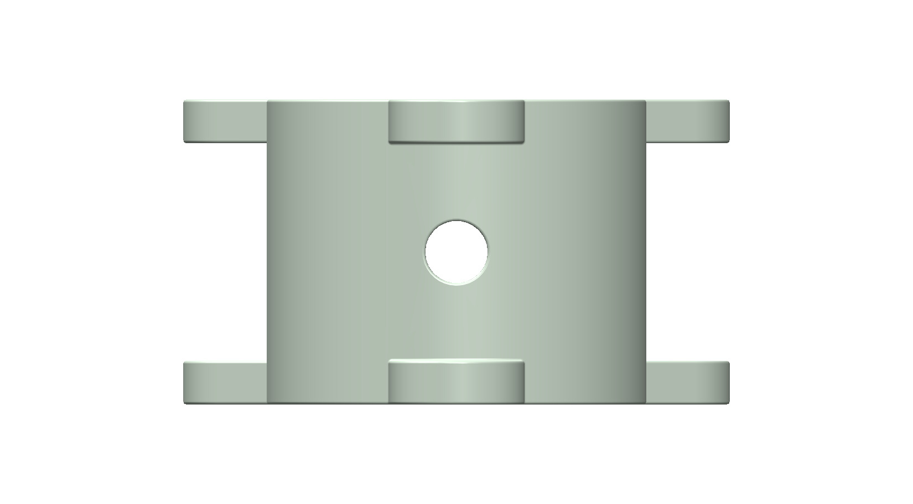
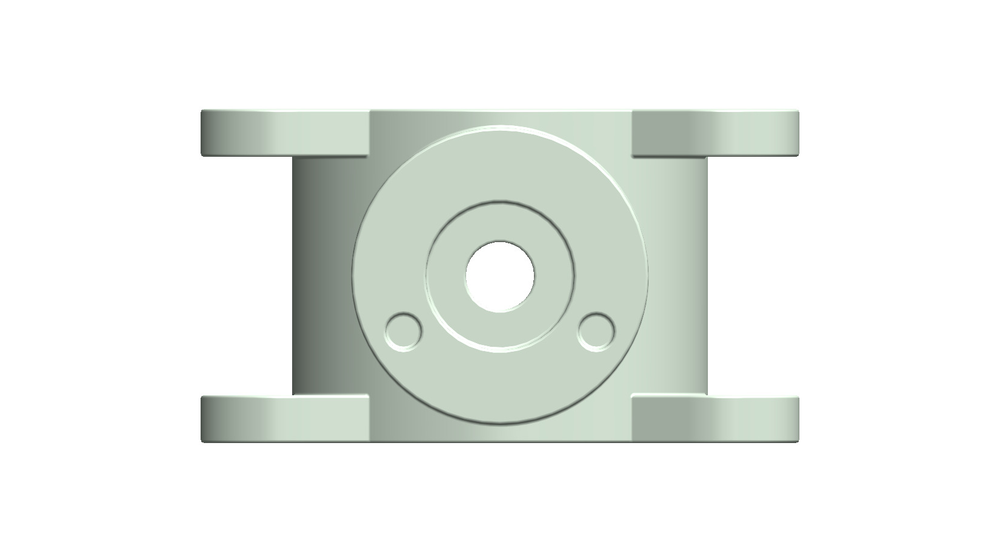
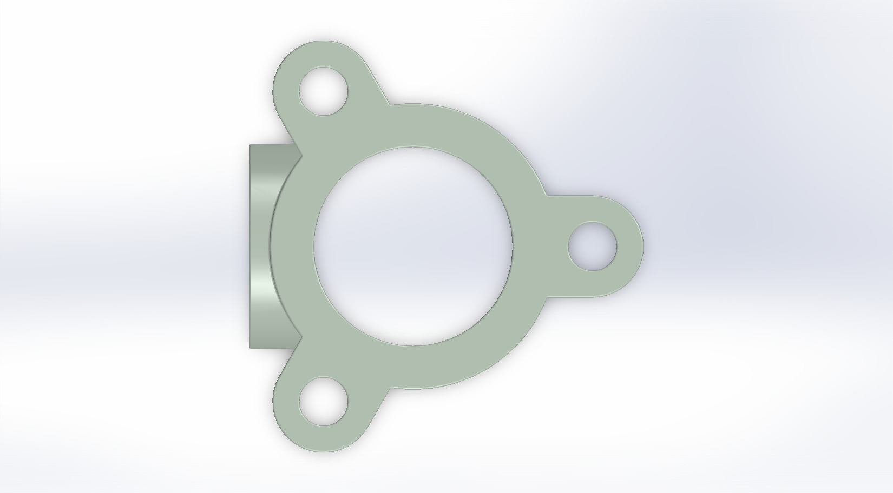
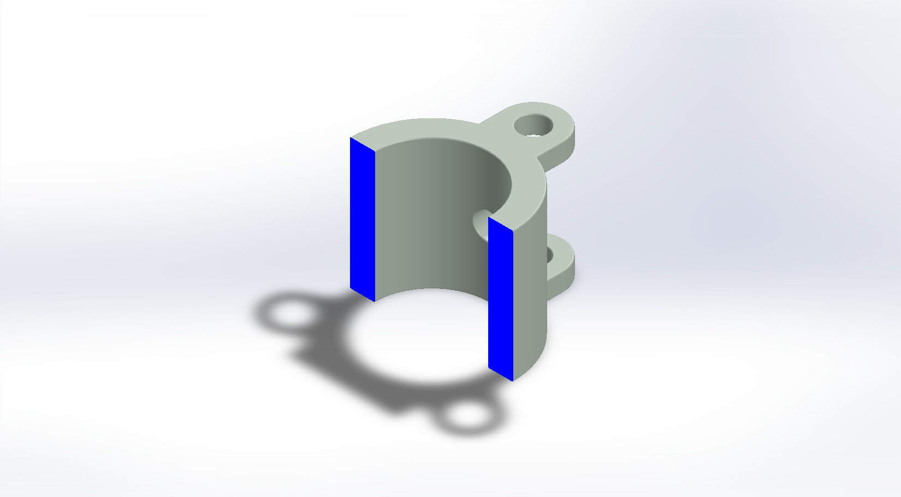

# A Cylindrical Housing with Paired Mounting Lugs and a Side Boss

## Summary

A housing is the body that holds and protects other parts, such as a bearing, a bushing, or a shaft, and the lugs on it, which are ear-like tabs with bolt holes, are what fasten it to a frame or plate. Housings like this matter because the way a housing is mounted, and how accurately its bore is made, decide how well the parts inside stay supported and aligned.

The model is a short cylindrical body with a large bore that passes straight through it. Three pairs of rounded lugs are spaced 120 degrees apart around the body, with one lug of each pair at the top end and the other at the bottom end, and every lug has a round through hole lined up with its partner. On the side of the body, between two of the lug pairs, a circular boss with a flat face carries a stepped central hole and two small holes, and the central hole continues through the body to the opposite wall. The housing was developed as a computational model in SolidWorks. The views below show the bore, the lugs, and the side boss from every side, along with a section view of the part. This prototype is a base concept design that can be developed further for a specific bearing, bushing, or shaft.

---

## Computational Design

|   View    |                                                                                                                        Image                                                                                                                        |
| :-------: | :-------------------------------------------------------------------------------------------------------------------------------------------------------------------------------------------------------------------------------------------------: |
| Isometric |  |
|   Left    |                       |
|   Right   |                      |
|   Back    |                                                 |
|   Front   |                                             |
|    Top    |                                                     |
|  Bottom   |                                                                       |
|  Section  |                 |

---

## Software Used

| Purpose |               Name                |
| :-----: | :-------------------------------: |
| Design  | SolidWorks 2024 (Student Version) |

---

## Feature Tree

| No  | Name |
| :-: | :--: |

---

## Feature Tree Image

| No  | Image |
| :-: | :---: |

---

## Applications [^1][^2][^3][^4][^5][^6][^7][^8]

- Bearing Housings for Rotating Shafts
- Bushing and Sleeve Bearing Holders
- Gearbox and Gear Housing Casings
- Engine and Transmission Case Mounting Points
- Bolted Mounts on Frames and Mounting Plates
- Clevis-Style Pinned Connections Between Paired Lugs
- Cast or Molded Housings with Bosses for Fastening and Locating

---

## Design Limitations

The design of the lugged housing was developed as a geometric prototype. That’s why the real-life design considerations, including material selection, casting or machining process, wall thickness and draft, fillets at the lug and boss junctions, bearing bore tolerances and fits, bolt and hole sizing, stress analysis of the lugs, sealing, and feasibility, have not been included.

---

## Future Improvements

The bore should be sized to a standard bearing or bushing, with a toleranced fit, a retaining shoulder or groove, and a finished surface. The lug holes and the gap between each pair of lugs should be sized for standard bolts or pins, and the boss holes should be dimensioned as threaded or clearance holes for real fasteners or fittings. Fillets or gussets at the lug and boss junctions, a material choice such as cast aluminum or cast iron, and draft and machining allowances would prepare the model for manufacture. A mating shaft, bearing, and mounting plate should then be added in an assembly, and the lugs should be checked with a stress analysis under bolt preload and operating loads.

---

## Acknowledgements

I would like to thank the [CAD CAM Tutorials](https://www.youtube.com/c/CADCAMTutorials) YouTube channel for its tutorials and learning resources, and [Mr. Md. Abdus Salam](https://mpe.iutoic-dhaka.edu/profile/salam/education), Drafting Instructor, Department of Mechanical and Production Engineering, Islamic University of Technology, for his guidance and support, and for his assistance in our ME 4210 3D Solid Modeling and Assembling lab course. I took assistance from [Claude](https://claude.ai), an AI assistant by [Anthropic](https://www.anthropic.com), in preparing this documentation. I provided the template, and Claude followed it and my instructions.

---

## References

[^1]: [Pillow block bearing - Wikipedia](https://en.wikipedia.org/wiki/Plummer_block)

[^2]: [Bearing (mechanical) - Wikipedia](<https://en.wikipedia.org/wiki/Bearing_(mechanical)>)

[^3]: [Plain bearing - Wikipedia](<https://en.wikipedia.org/wiki/Bushing_(bearing)>)

[^4]: [Gear housing - Wikipedia](https://en.wikipedia.org/wiki/Gear_housing)

[^5]: [What Does Lug Mean in Automotive, Electrical, and Mechanical Systems?](https://engineerfix.com/what-does-lug-mean-in-automotive-electrical-and-mechanical-systems/)

[^6]: [Flange - Wikipedia](https://en.wikipedia.org/wiki/Flange)

[^7]: [Clevis fastener - Wikipedia](https://en.wikipedia.org/wiki/Clevis_fastener)

[^8]: [Design of plastic components - Wikipedia](https://en.wikipedia.org/wiki/Design_of_plastic_components)
