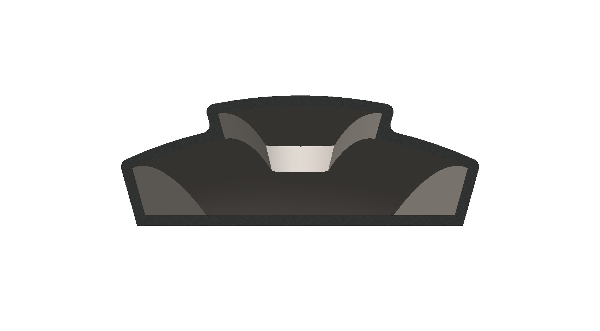
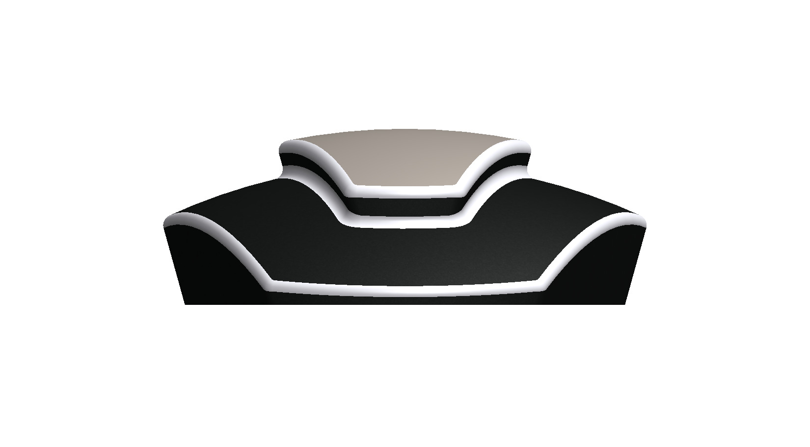
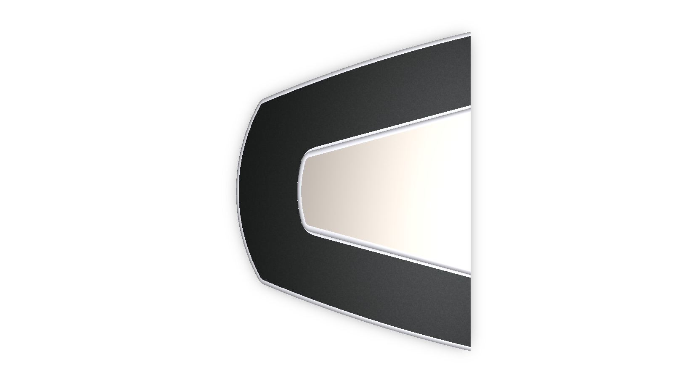
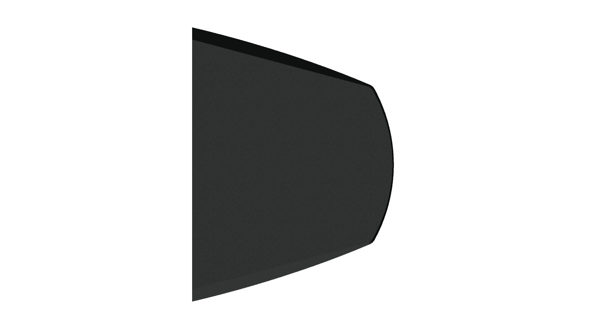
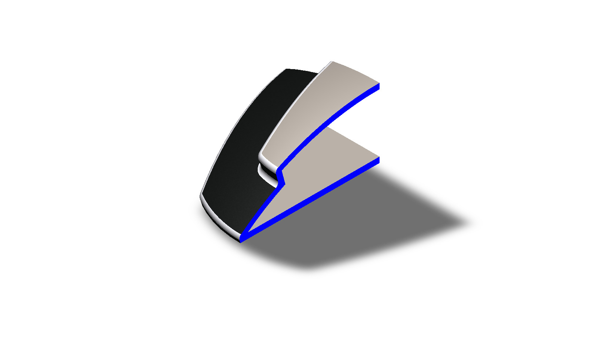

# A Hollow Tapered Shell with a Stepped Raised Center Strip

## Summary

Thin-walled molded shells and cover pieces enclose, protect, and give a finished look to many products, from vehicle trim and badges to appliance and electronics housings. Making them hollow saves material and weight while still keeping a styled outer surface. The exact function of this part is not specified, so it is described here by its geometry.

The model is a hollow, thin-walled shell that is widest and tallest at a flat, open rear edge and tapers down to a gently curved nose with angled corners. Its dark outer body carries a lighter tan strip along the center line, raised above the body in steps, and a dark band wraps around the nose end of the strip in a V or U shape. All the step edges are rounded, and the underside is a plain closed surface. The part was developed as a computational model in SolidWorks. The views below show the shell from every side, along with a section view of its thin walls. This prototype is a base concept design that can be developed further into a real cover or trim piece.

---

## Computational Design

|   View    |                                                                                                       Image                                                                                                        |
| :-------: | :----------------------------------------------------------------------------------------------------------------------------------------------------------------------------------------------------------------: |
| Isometric |  |
|   Left    |     |
|   Right   |    |
|   Back    |                   |
|   Front   |              |
|    Top    |    |
|  Bottom   |                                                            |
|  Section  |                   |

---

## Software Used

| Purpose |               Name                |
| :-----: | :-------------------------------: |
| Design  | SolidWorks 2024 (Student Version) |

---

## Feature Tree

| No  | Name |
| :-: | :--: |

---

## Feature Tree Image

| No  | Image |
| :-: | :---: |

---

## Applications [^1][^2][^3][^4][^5]

- Automotive Exterior Badges and Emblem Housings
- Decorative Trim Pieces and End Caps on Vehicles, Boats, Aircraft, and Appliances
- Cosmetic Housings and Covers for Consumer Products
- Covers for Electronic and PCB Enclosures
- Housings for Wearable and Smart Home Devices
- Telecom and Industrial Gateway Covers
- Covers and Housings for Medical and Industrial Equipment

---

## Design Limitations

The design of the stepped shell was developed as a geometric prototype. That’s why the real-life design considerations, including wall thickness selection, material selection, draft angles and mold design, stress and stiffness analysis, mounting and fastening features, tolerances and fits, surface finish and coloring, and feasibility, have not been included.

---

## Future Improvements

The shell currently has no way of being attached to anything, so the next step is to decide what it covers and to add mounting features at the open rear, such as screw bosses, snap fits, or clips. A uniform wall thickness suited to the chosen material and draft angles on the vertical faces should then be applied so that the part can be molded, and ribs can be added inside to stiffen the large curved top surface. The shell should also be placed in an assembly with its mating part to check fit, gaps, and flushness along the stepped edges. The two-tone appearance could be produced with a painted or two-shot finish, and a 3D-printed prototype should be used to check the look and feel before any tooling is considered.

---

## Acknowledgements

I would like to thank the [CAD CAM Tutorials](https://www.youtube.com/c/CADCAMTutorials) YouTube channel for its tutorials and learning resources, and [Mr. Md. Abdus Salam](https://mpe.iutoic-dhaka.edu/profile/salam/education), Drafting Instructor, Department of Mechanical and Production Engineering, Islamic University of Technology, for his guidance and support, and for his assistance in our ME 4210 3D Solid Modeling and Assembling lab course. I took assistance from [Claude](https://claude.ai), an AI assistant by [Anthropic](https://www.anthropic.com), in preparing this documentation. I provided the template, and Claude followed it and my instructions.

---

## References

[^1]: [Enclosure Design for Injection Molding | Fictiv](https://www.fictiv.com/articles/enclosure-design-for-injection-molding)

[^2]: [How to Design Injection-Molded Enclosures for Electronics: Tips from Engineering Practice](https://promwad.com/news/injection-molded-enclosure-design)

[^3]: [Injection Molding Wall Thickness Guidelines](https://www.protolabs.com/resources/design-tips/improving-part-design-with-uniform-wall-thickness/)

[^4]: [US8702135B2 - Radar compatible automotive badge and fascia - Google Patents](https://patents.google.com/patent/US8702135)

[^5]: [US5350608A - Decorative trim with one-piece plastic cover - Google Patents](https://patents.google.com/patent/US5350608)
