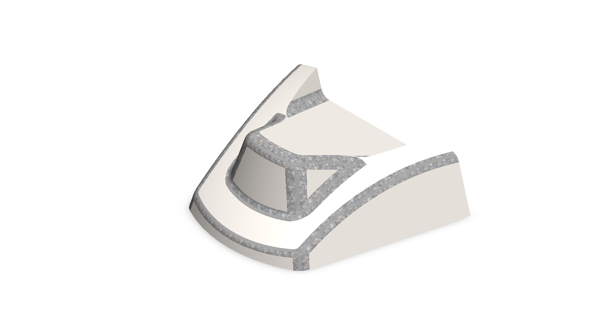
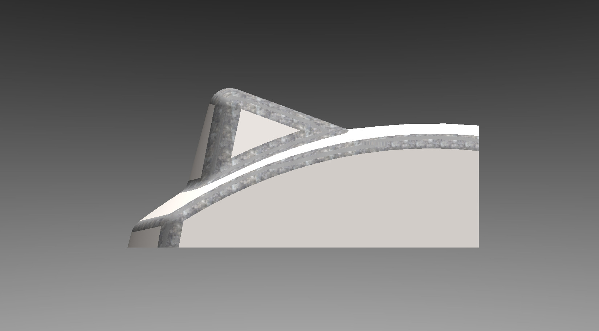
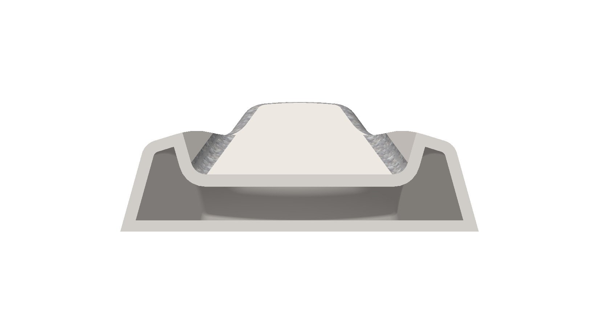
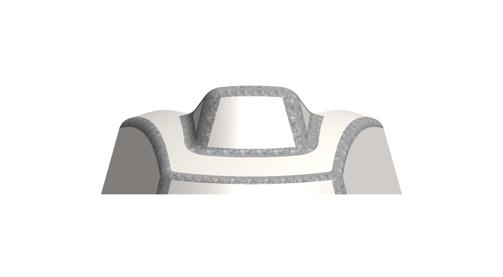
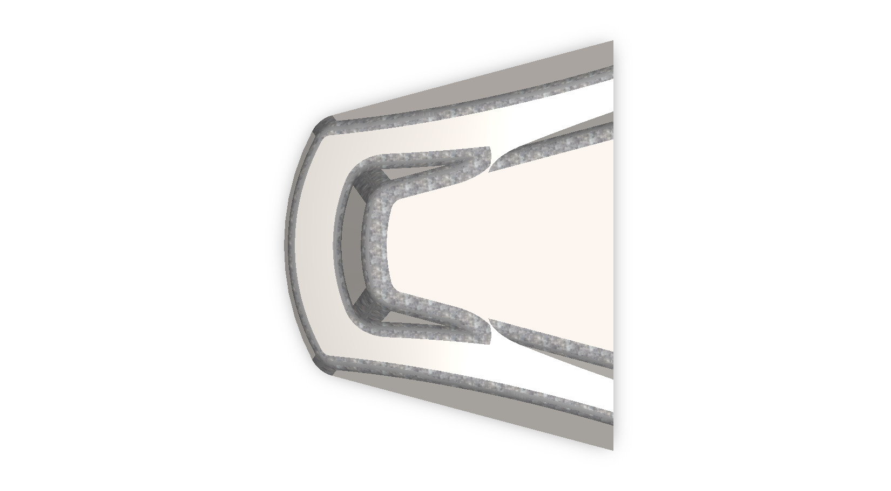
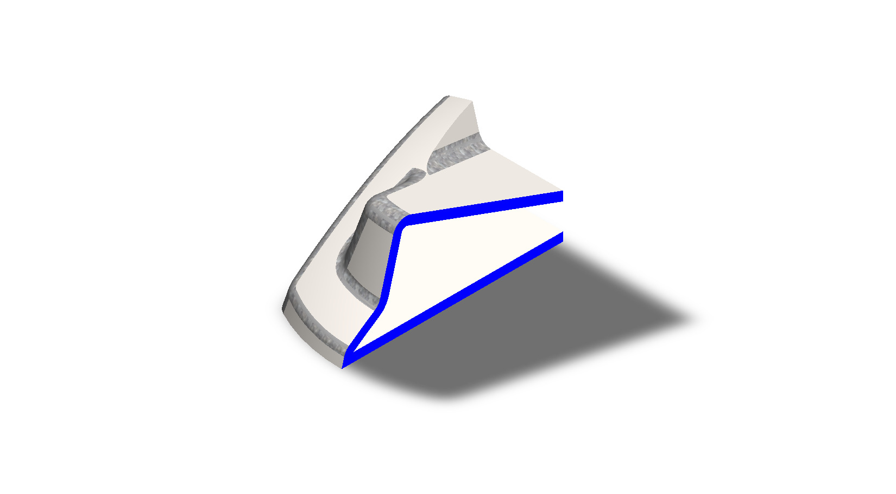

# A Thin-Walled Curved Shell with a Raised Nose Bulge

## Summary

Thin-walled shells such as vehicle body panels, fairings, and equipment covers give a product a smooth outer form without the weight of a solid body. They often carry raised bulges or scoops, either to guide air or to shape the look of the surface, and their curvature, wall thickness, and edges have to be modeled with care. The exact real-world function of this part is not identified, so it is named here by its geometry.

The model is a hollow, thin-walled body with a flat base. In plan it is narrow and rounded at one end, the nose, and widens toward the other end, which is cut off straight. The top is arched, with two raised shoulders along the sides and a lower channel between them. Near the nose, a flat-topped, trapezoid-shaped bulge rises above the channel and is surrounded by a curved groove. Narrow speckled grey bands trace the outlines of the bulge, the shoulders, and the nose. The shell was developed as a computational model in SolidWorks, and the back and section views show its thin walls around an empty interior. This prototype is a base concept design that can be developed further into a real cover, fairing, or body panel.

---

## Computational Design

|   View    | Image |
| :-------: | :---: |
| Isometric |  |
|   Right   |  |
|   Back    |  |
|   Front   |  |
|    Top    |  |
|  Bottom   |  |
|  Section  |  |

---

## Software Used

| Purpose |               Name                |
| :-----: | :-------------------------------: |
| Design  | SolidWorks 2024 (Student Version) |

---

## Applications [^1][^2][^3][^4][^5]

- Automotive Hood Panels with Power Bulges
- Hood Scoops for Engine Air Intake or Styling
- Motorcycle Fairings and Nose Shells
- Aircraft Fairings and Cockpit Pods
- Lightweight Fiberglass or Carbon-Fiber Body Panels
- Thin-Walled Molded Plastic Covers and Housings

---

## Design Limitations

The design of the thin-walled shell was developed as a geometric prototype. That’s why the real-life design considerations, including material selection (for example, sheet metal, molded plastic, or composite), wall thickness and stiffness checks, strength and stress analysis, airflow performance, mounting features, tolerances & fits, manufacturing process and draft angles, surface finish and texture, and feasibility, have not been included.

---

## Future Improvements

The first step is to decide what the part is for, such as a hood panel, a fairing, or an equipment cover, and to set its real overall dimensions and wall thickness from that purpose. The open wide end could then be joined to a mating panel or given a mounting flange, and ribs, bosses, or fasteners could be added inside the hollow for stiffness and attachment. If the raised bulge is meant to work as an air scoop, it needs a proper opening and a duct, and a simple airflow study should check its effect on drag and flow. For a molded or composite part, draft angles, uniform wall thickness, and generous inside radii should be added, and the speckled edge bands could be turned into a deliberate surface texture or edge treatment. A mirrored or extended version of the shell could also be built to form a complete panel.

---

## Feature Tree

| No  | Name |
| :-: | :--: |

---

## Feature Tree Image

| No  | Image |
| :-: | :---: |

---

## Acknowledgements

I would like to thank the [CAD CAM Tutorials](https://www.youtube.com/c/CADCAMTutorials) YouTube channel for its tutorials and learning resources, and [Mr. Md. Abdus Salam](https://mpe.iutoic-dhaka.edu/profile/salam/education), Drafting Instructor, Department of Mechanical and Production Engineering, Islamic University of Technology, for his guidance and support, and for his assistance in our ME 4210 3D Solid Modeling and Assembling lab course. I took assistance from [Claude](https://claude.ai), an AI assistant by [Anthropic](https://www.anthropic.com), in preparing this documentation. I provided the template, and Claude followed it and my instructions.

---

## References

[^1]: [Hood scoop - Wikipedia](https://en.wikipedia.org/wiki/Hood_scoop)

[^2]: [Hood (car) - Wikipedia](https://en.wikipedia.org/wiki/Hood_(car))

[^3]: [Motorcycle fairing - Wikipedia](https://en.wikipedia.org/wiki/Motorcycle_fairing)

[^4]: [Aircraft fairing - Wikipedia](https://en.wikipedia.org/wiki/Aircraft_fairing)

[^5]: [Wall Thickness Guide For Plastic Part Design](https://xcentricmold.com/how-wall-thickness-impacts-injection-mold-part-design/)
