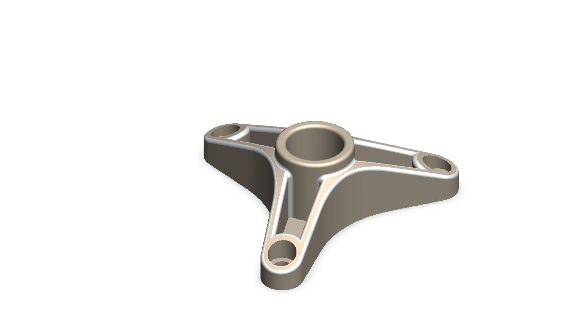
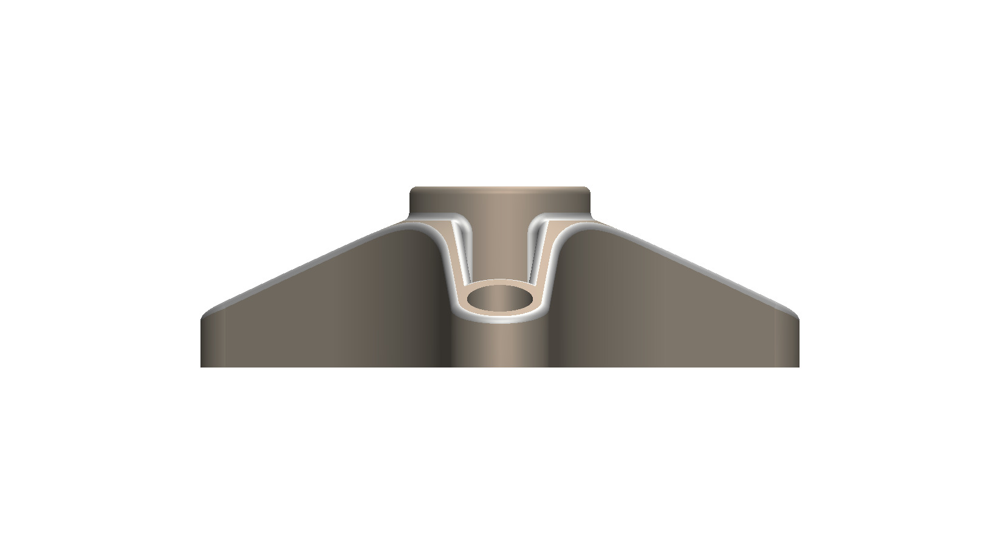
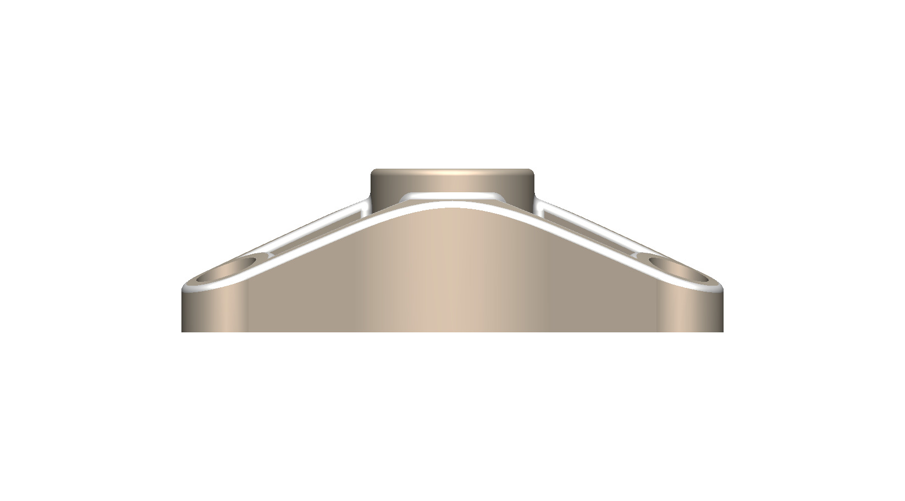
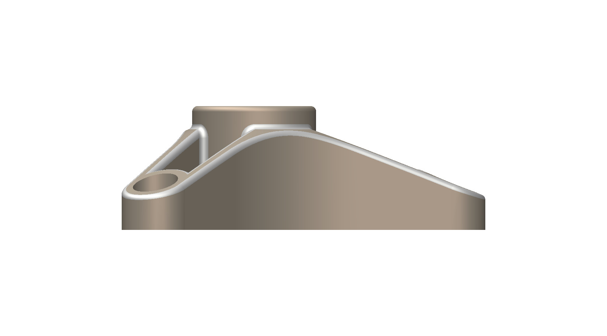
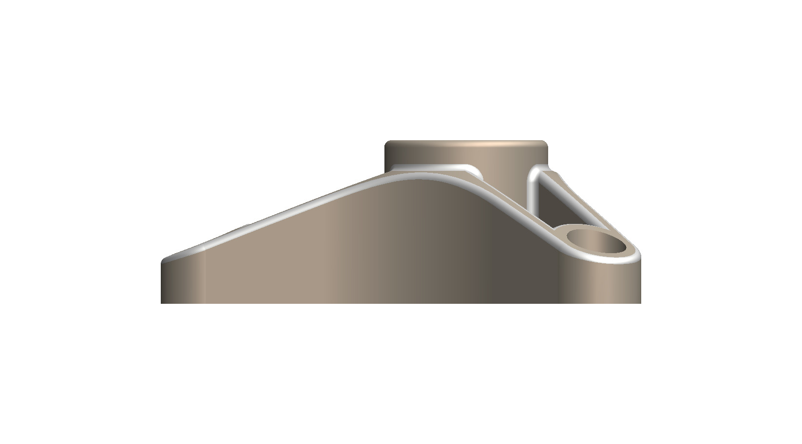
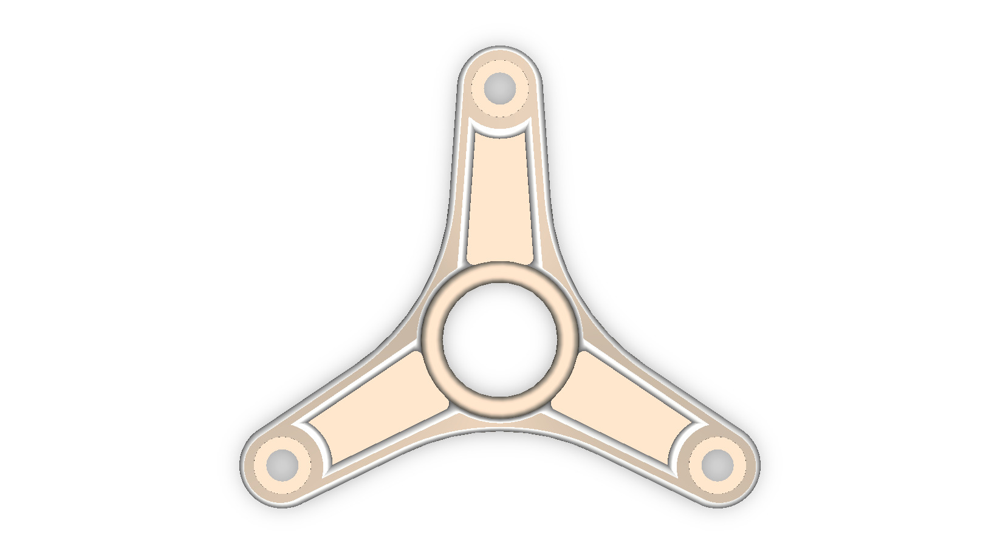
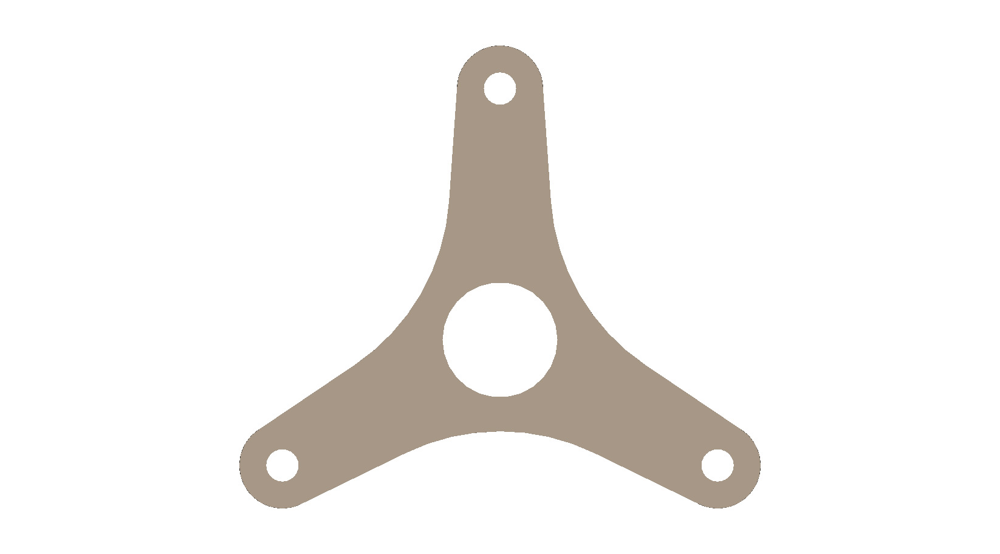
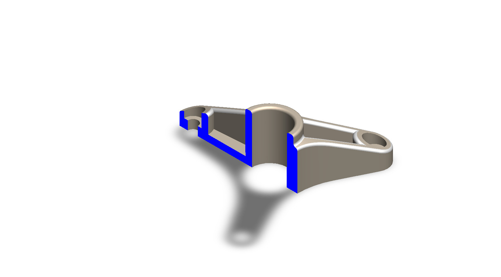

# A Three-Arm Bracket with a Central Hub and Pocketed Arms

## Summary

A bracket with a central hub and arms spread evenly around it is a simple way to hold a shaft, bearing, or rotating part at one point and fix it to a frame at several points. Three fixing points always define a plane, so a three-armed mount seats without rocking, and the open space between the arms saves material compared with a solid plate. Hub-and-arm parts of this kind, often called spiders, are used in fans, machinery supports, and architectural fittings.

The model is a three-armed body with the arms spaced evenly, 120 degrees apart, around a raised tubular hub that has a through bore. Each arm ends in a rounded lug with a stepped through hole, and the top of each arm is hollowed into an open pocket surrounded by a thin perimeter wall. The arms slope down from the hub to the lugs, and smooth concave curves join neighboring arms. The bracket was developed as a computational model in SolidWorks. This prototype is a base concept design that can be developed further into a real mounting bracket once its purpose and loads are known.

---

## Computational Design

|   View    | Image |
| :-------: | :---: |
| Isometric |  |
| Left |  |
| Right |  |
| Back |  |
| Front |  |
| Top |  |
| Bottom |  |
| Section |  |

---

## Software Used

| Purpose |               Name                |
| :-----: | :-------------------------------: |
| Design  | SolidWorks 2024 (Student Version) |

---

## Applications [^1][^2][^3][^4][^5]

- Three-Bolt Flanged Bearing Housings on Machine Frames
- Conveyor, Packaging, and Food-Processing Machinery Supports
- Fan Spiders that Carry Blades on a Central Hub
- Hub Support Spiders in Gyratory Rock Crushers
- Glass Canopy and Facade Spider Fittings

---

## Design Limitations

The design of the three-arm bracket was developed as a geometric prototype. That’s why the real-life design considerations, including material selection, manufacturing process (casting or machining), wall and pocket thickness, load and stress analysis, fastener and bolt-circle specification, tolerances and fits for the central bore, and surface finish, have not been included.

---

## Future Improvements

The first step is to decide what the bracket will carry, so that the bore diameter, the bolt circle, and the fastener size can be taken from the mating shaft, bearing, or frame instead of being set by eye. The stepped lug holes can then be replaced with standard counterbores for a chosen bolt, and the hub can be given a bearing seat, a keyway, or a set-screw hole if it has to hold a rotating part. A static stress analysis with the loads applied at the lugs would show how thin the pocket walls and floors can safely be, and how deep the pockets can go to save weight. Draft angles and generous fillets should be added if the part is to be cast, and a 3D-printed prototype could be used to check the fit with the mating parts before moving to a final material and process.

---

## Feature Tree

| No  | Name |
| :-: | :--: |

---

## Feature Tree Image

| No  | Image |
| :-: | :---: |

---

## Acknowledgements

I would like to thank the [CAD CAM Tutorials](https://www.youtube.com/c/CADCAMTutorials) YouTube channel for its tutorials and learning resources, and [Mr. Md. Abdus Salam](https://mpe.iutoic-dhaka.edu/profile/salam/education), Drafting Instructor, Department of Mechanical and Production Engineering, Islamic University of Technology, for his guidance and support, and for his assistance in our ME 4210 3D Solid Modeling and Assembling lab course. I took assistance from [Claude](https://claude.ai), an AI assistant by [Anthropic](https://www.anthropic.com), in preparing this documentation. I provided the template, and Claude followed it and my instructions.

---

## References

[^1]: [SKF Triangular 3-Bolt Units](https://www.acorn-ind.co.uk/skf/bearings/bearing-units/ball-bearing-units/triangular-3-bolt-units)

[^2]: [US6942457B2 - Fan assembly and method](https://patents.google.com/patent/US6942457B2/en)

[^3]: [US4053260A - Double spider stiffening assembly for fan blades](https://patents.google.com/patent/US4053260)

[^4]: [US8070084B2 - Spider having spider arms with open channel](https://patents.google.com/patent/US8070084)

[^5]: [Spider Glass Fitting & Patch Fitting - Point Fixed Glazing](https://mccoymart.com/post/what-is-point-fixed-glazing-patch-fitting-spider-glass-fitting/)
